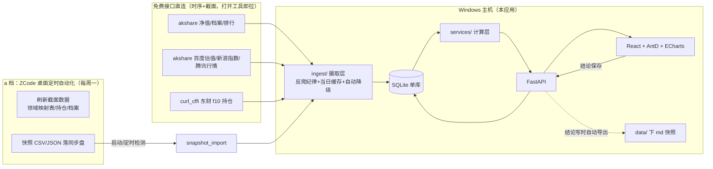
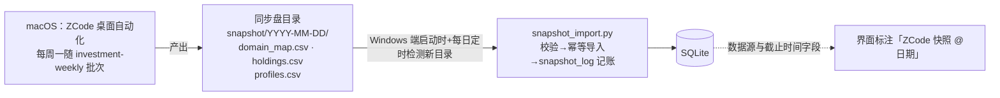

# 实现方案 · 基金研究工作台 v1（实现方案设计产出物）

> 阶段：实现方案设计 → 待用户验收 · 生成于 2026-10-15
> 上游：PRD v0.2（已验收）· 技术选型定稿（已验收，含 zvt spike 否决结论）
> 硬约束来源：选型文档 §2 工程结论（多源映射/反爬纪律/版本锁定/UTF-8）、PRD §4 非功能需求
> 变更（2026-10-17 拷问定稿）：① 新增 `my_position` 表（§3），持仓录份额+市值快照，组合评估权重默认由持仓带出；② 口径表补「分红处理/基准对齐」两条 + 反爬降级路由实锤（§5/§6），并纳入 M2 验收；③ 里程碑范围与验收线不变，日历按用户实际投入重排（每周小时数待补）；④ 研究池 7 只名单定稿（见 `docs/调查报告-重仓基金-20261017.md` 附录）。
> 变更（2026-10-20 复查修正）：§6「区间收益率/最大回撤/分红处理」口径反转——累计净值只作分红核对常数、**不算区间收益**（常数阻尼失真实测见 `docs/复查报告-重仓基金-20261020.md` §四）。

## 1. 总体架构与模块划分

三层：**摄取层 → 计算层 → 展示层**，数据落 SQLite 单库，结论层双写 md 快照。

```text
fund-quant-tool/
├── backend/                    # FastAPI 应用（Python 3.12，复用根 uv 环境）
│   └── app/
│       ├── main.py             # 入口：装配路由、启动时建表、CORS
│       ├── config.py           # 路径与开关（DB 位置、缓存目录、快照目录）
│       ├── db.py               # sqlite3 薄封装（显式 UTF-8、建表 DDL 集中于此）
│       ├── schemas.py          # Pydantic 请求/响应模型
│       ├── ingest/             # 【摄取层】唯一允许外呼网络的模块
│       │   ├── source_map.py       # 字段→客户端映射 + 自动降级路由（学 Vibe-Trading 多源抽象）
│       │   ├── akshare_client.py   # 净值/档案/排行/估值/指数/腾讯行情（akshare==1.19.1 锁版本）
│       │   ├── curl_cffi_client.py # 东财 f10 前十大持仓（TLS 指纹伪装）
│       │   ├── snapshot_import.py  # 同步盘快照 CSV/JSON → SQLite（a 档截面链路入口）
│       │   └── refresh.py          # 刷新编排：时序即时 + 截面周更 + 当日磁盘缓存
│       ├── services/           # 【计算层】纯函数，不碰网络
│       │   ├── metrics.py          # 收益(区间/年化)/最大回撤/年化波动/夏普（自算口径，沿用 investment-weekly 规范）
│       │   ├── overlap.py          # 重叠度穿透：同名合并、组合权重、有效持仓数、未披露部分
│       │   └── portfolio.py        # 组合净值合成、相关性矩阵、基准超额
│       └── routers/            # 【展示层接口】按 PRD 四子页 + 画像库划分
│           ├── funds.py            # 画像库 CRUD、领域标签、结论层读写（写时导出 md 快照）
│           ├── dashboard.py        # 仪表盘总览
│           ├── portfolio.py        # 组合评估三件套
│           ├── holdings.py         # 穿透分析
│           └── explore.py          # 领域探索（映射表 + 排行关键字兜底）
├── frontend/                   # Vite + React + TS + Ant Design + ECharts
│   └── src/
│       ├── api/                # fetch 封装（/api 前缀，dev 由 Vite 代理到 8000）
│       ├── pages/              # Dashboard / FundLibrary / FundDetail /
│       │                       # DomainExplore / PortfolioEval / OverlapAnalysis
│       └── components/         # ECharts 封装（净值/回撤/相关性热力图）、指标表
├── data/                       # SQLite 库 + md 快照导出目录（库文件不入 git）
├── scripts/                    # probe 探针（常备体检）+ 运维脚本
├── notebooks/ notes/           # 研究与教学（保留现状）
└── docs/                       # PRD / 选型 / 本文档
```

**划分原则**：① 网络外呼只许出现在 `ingest/`（反爬纪律单点执行：sleep + 指数退避 + 当日缓存 + 降级）；② `services/` 纯计算可单测；③ router 不写 SQL 细节、不写指标公式；④ 单 uv 环境同时装研究依赖（jupyter/pandas）与应用依赖（fastapi）——单用户本地工具，不分环境。

## 2. 数据流图

### 2.1 总链路（时序即时 + 截面周更 + 快照兜底）



### 2.2 a 档快照链路细节（Mac 产数据 → Windows 消费）



- **幂等**：按快照日期目录一次导入，重复导入不产生重复行（唯一键约束 + 导入记账）。
- **降级序**：截面字段先查 SQLite 内快照 → miss 才走 akshare/curl_cffi 即时拉 → 都失败界面明确标注数据缺口，不静默造假。

## 3. SQLite 库表设计（v1）

| 表 | 关键列 | 说明 |
|---|---|---|
| `fund` | code PK, name, pool_type(持仓/研究池), domain_tags, created_at | 池成员与标签，人/探索页写入 |
| `my_position` | code PK(仅持仓池), shares, market_value, value_as_of, updated_at | 实际持仓份额+市值快照（2026-10-17 新增）；组合评估默认权重 = `shares×最新acc_nav / Σ`，份额不变权重随净值自动更新；买卖流水后期可加 `trade_log`（招行 App 交易记录截图誊录） |
| `fund_profile` | code, as_of, 经理/规模/成立/费率三档/基准/股票仓位 | 档案快照，保留历史 as_of |
| `fund_nav` | (code, date) 唯一, unit_nav, acc_nav | 单位+累计净值（复权口径决策：一律用累计净值算收益，见 §6 口径表） |
| `fund_metric` | code, as_of, 近1/3/6月/YTD/1年收益, max_dd, ann_vol, sharpe | 计算层产出落库，周更 |
| `fund_holding` | (code, report_date, stock_code) 唯一, stock_name, weight | 前十大；报告期显式存列 |
| `stock_daily` | (stock_code, date) 唯一, OHLC, volume | 穿透层个股行情（腾讯源） |
| `stock_valuation` | (stock_code, date) 唯一, pe_ttm, pb | 百度源，算 5 年分位 |
| `domain_map` | domain, fund_code, fund_name, updated_at | ZCode 周更领域映射（探索页主数据） |
| `note` | fund_code PK, content(md), updated_at | 结论层；写时导出 `data/notes/{code}.md` |
| `snapshot_log` | snapshot_date, filename, rows, imported_at | 快照导入审计 |

技术选择：**标准库 `sqlite3` 直写 SQL，v1 不引 ORM**（10-20 只基金规模，SQL 可读性对教学更好；复杂查询出现时再评估 SQLAlchemy）。

## 4. API 草案（v1）

| 方法/路径 | 用途（对应 PRD） |
|---|---|
| `GET/POST /api/funds`、`PATCH /api/funds/{code}` | 画像库列表/入池/改标签（FR1） |
| `GET /api/funds/{code}` | 单基金画像：档案+指标+持仓+结论（FR1、故事4） |
| `PUT /api/funds/{code}/note` | 结论层读写，写时导出 md（FR1 双层结构） |
| `GET /api/dashboard` | 持仓总览（FR4 首页） |
| `POST /api/portfolio/eval` | codes+weights（默认从 `my_position` 带出，可手调）→ 并排指标表+组合净值/回撤/相关性+基准超额（FR2） |
| `GET /api/portfolio/overlap?codes=` | 重叠穿透：合并重仓股、组合权重、有效持仓数、未披露部分（FR2③/FR3） |
| `GET /api/explore/domains`、`GET /api/explore/{domain}` | 领域列表/领域内基金+初步指标（FR1 入池机制） |
| `POST /api/explore/pool` | 领域探索页入研究池+打标签（FR1） |
| `POST /api/refresh?scope=` | 手动触发刷新（时序/截面/全部），Windows 任务计划程序也调它 |
| `GET /api/health` | 存活+DB 路径+数据新鲜度摘要 |

## 5. 里程碑（v1 ≈ 9 周，每周 6-10h；即 ROADMAP 阶段 1 的产品化形态）

| # | 周期 | 交付 | 验收要点 |
|---|---|---|---|
| M1 | 第1周 | 项目骨架（本文件 §1 落地）+ 画像库 CRUD + `my_position` 录入 | 5 持仓（含份额+市值）+7 研究池可录入，前端能看列表 |
| M2 | 第2-3周 | 摄取层 + 指标计算 + 单基金画像页 | 20 字段自动填充；000390 净值对上 CSV（0.000%）；口径三条回归（分红/基准对齐/新浪降级路由各 1 用例） |
| M3 | 第4-5周 | 组合评估三件套 + 基准超额 | 等权/手调权重可切换；相关性热力图可用 |
| M4 | 第6周 | 穿透分析页 | 新易盛/中际旭创组合权重排前列、超标标色；报告期滞后标注 |
| M5 | 第7-8周 | 领域探索页 + 快照链路 + 任务计划程序 | 医药领域入池 000960 跑通；快照幂等导入 |
| M6 | 第9周 | 验收 + 打磨 | 重做 2026-10-13 诊断（PRD 验收①）；3 基金抽验 ≤0.5pct（验收②） |

风险缓冲：akshare 接口漂移（乐咕先例）→ probe 常备 + 锁版本 + source_map 降级路由已内建；QDII 净值滞后 → 界面截止时间标注；东财 push2 行情域反爬（Windows 实测 ProxyError，与 macOS 一致）→ 指数/个股一律走新浪源，不把东财行情列入可用路由。

> 日历说明（2026-10-17 用户确认）：上表周期列仍为 9 周理想排期，M2-M6 范围与验收线**不变**；实际日历按用户每周可投入小时数重排后再更新本列，宁可顺延不降验收标准。

## 6. 指标口径表（v1 强制，写入代码注释与界面 tooltip）

| 指标 | 口径 |
|---|---|
| 区间收益率 | 窗内无分红：`unit_nav(t)/unit_nav(t0) - 1`（精确）；窗内有分红：`(unit_nav(t) + 窗内分红现金) / unit_nav(t0) - 1`（现金口径）。**禁止用累计净值算区间收益**——历史分红常数会阻尼失真（000390 实测：常数 3.078 把真实 -29.6% 阻尼成 -13.9%） |
| 年化收益 | 自算 `(1+R)^(365/days) - 1`，**不用任何数据商「年化」列**（Wind 列约为几何年化 2 倍的教训） |
| 最大回撤 | 单位净值 running max：`min(nav/cummax(nav)-1)`；窗内含分红日时先用「单位+窗内累计分红」重构序列再取 |
| 年化波动率 | 日收益 std × `sqrt(252)`；QDII 用可得交易日，不强补 |
| 夏普 | `(年化收益 - 无风险2%)/年化波动`，无风险利率固定标注 |
| 穿透权重 | Σ(基金权重 × 个股占净值比例)，前十大之外汇总为「未披露部分」 |
| 分红处理 | 分红事件单独建表；累计-单位差值**仅作核对常数**（000390 恒为 3.078），不进任何区间计算。实测教训两则：① 000390 于 2026-06 分红 0.463 元/份，窗内含分红日时单位净值口径失真（YTD 少算约 3pp+）；② 用累计净值算窗内无分红的区间，历史分红常数会把跌幅人为压小（-29.6% → -13.9%，2026-10-20 复查实测，两只华商克隆持仓交叉验证） |
| 基准对齐 | 基金与基准先按**共同交易日**对齐再算超额（实测教训：004195/012920 净值滞后 1 天，直接错位对比会虚增/虚减超额 2pp 量级） |

## 7. Windows 部署要点（选型文档 §4 落实）

1. 全链路显式 `encoding="utf-8"`（db.py / 快照导入 / md 导出统一遵守）。
2. 常驻：开机自启脚本拉起 `uvicorn`（127.0.0.1:8000）+ 前端 `vite preview` 或构建后静态托管；浏览器访问 localhost。NSSM 注册为备选。
3. 定时：任务计划程序每周一调 `POST /api/refresh?scope=cross_section` + 每日快照目录检测。
4. `.env` 仅存 `TYPESAFE_API_KEY`（阶段 3 用），不入库。

## 8. 本阶段验收清单

1. 模块划分、数据流图、库表、API 草案、里程碑经用户确认；
2. 骨架代码跑通：`uvicorn` 起、前端起、画像库页可录入并持久化；
3. 确认后进入 M2（摄取层）实现。
